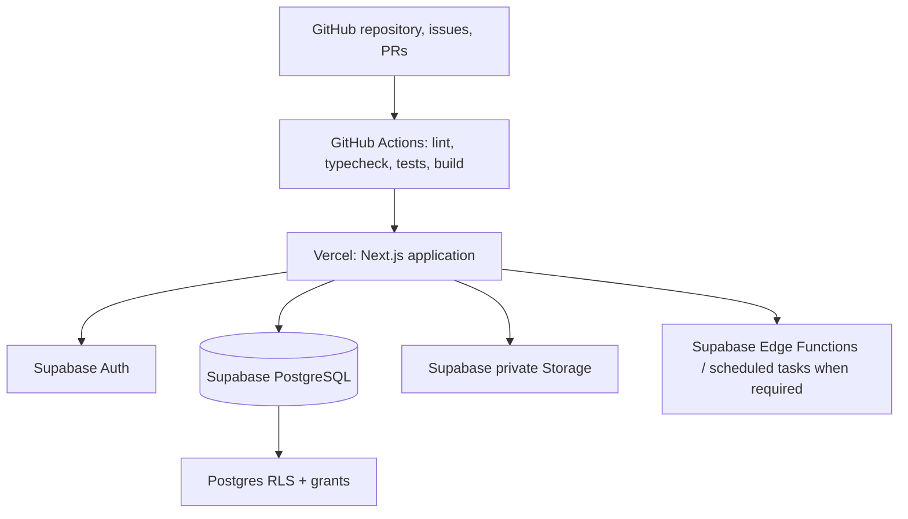

# ILMOFAHM — Architecture and Stack Decision

**Status:** Accepted for initial build; revisit with evidence as the product grows.

## 1. Architecture choice

Use a **modular monolith** for the MVP. This is not a single unstructured pile of code: each business domain has its own types, validation, queries, use-cases, UI routes, authorization checks, and tests. Deploying one web app initially keeps operations simple while preserving boundaries for future extraction.

## 2. Technology decision

| Concern | Initial choice | Notes |
|---|---|---|
| Frontend and server entry points | Next.js App Router + TypeScript | Server Components for read-heavy pages where appropriate; Route Handlers/server actions for validated mutations. Keep business logic out of components. |
| Styling and primitives | Tailwind CSS + shadcn/ui | Accessible reusable components; define design tokens and avoid a custom component library before needed. |
| Forms and validation | React Hook Form + Zod | Shared input schemas where suitable; server validates independently. |
| Authentication | Supabase Auth with secure SSR cookie integration | Verify sessions on the server. Re-check membership/permissions on each protected operation. |
| Data store | Supabase PostgreSQL | Relational constraints and transactions for school, academic and financial data. |
| Database change management | Supabase CLI + ordered SQL migrations | Migration files are reviewable and reproducible. Never treat manual dashboard edits as the source of truth. |
| Data access | `@supabase/supabase-js` and the official SSR integration wrapped by local server/browser client helpers | Keep privileged clients server-only. The Supabase docs currently describe `@supabase/ssr` as beta, so pin the exact dependency version, isolate SDK-specific details behind local helpers, and review release notes before upgrades. |
| File storage | Private Supabase Storage buckets with object access policies | Store metadata in DB. Verify file type/size and access rights; plan separate object backup/retention because DB backups do not contain stored file objects. |
| Tests | Vitest for unit tests; SQL/RLS tests through Supabase CLI; Playwright for critical browser flows | Add each kind as the corresponding feature arrives. |
| Error/health | Structured server logs and an error-monitoring provider selected before pilot | Never log passwords, tokens, or unnecessary child/financial data. |
| Deployment | GitHub + Vercel + separate Supabase environments | Vercel deploys the Next.js app; database migrations are a separate controlled release step. |

## 3. Why Supabase fits

Supabase supplies managed Postgres, Auth, Storage, and RLS in one platform. PostgreSQL is a good fit for related entities and transactional invariants such as enrollment, attendance submission, and fee ledgers. RLS gives a second enforcement layer at the database boundary.

**Important limitations and controls:**

- RLS policies and SQL grants both matter. A policy does not automatically remove broad table grants. Review both for every exposed table.
- A privileged key can bypass RLS. It must remain server-only and be used only for tightly controlled operations that require it.
- Database backups do not include objects stored through Supabase Storage. Establish object backup/retention separately and test restores.
- Supabase Auth identifies a user; it does not define the user's school permissions. ILMOFAHM owns organization memberships, role assignment, campus scope, and guardian/student relationships.
- Supabase preview database branching is optional. Start with a local project and separate staging/production projects; evaluate branch previews later against cost and team workflow.

## 4. Feature module boundaries

Initial code should be organized by domain in `apps/web/src/features/` (exact internal filenames can evolve):

- `platform`: organization onboarding, memberships, roles, campus scope, subscriptions/status.
- `organization`: settings, academic years, terms, school grades/sections, academy courses/batches.
- `students`: student profiles, guardians, admissions, enrollments, imports.
- `attendance`: sessions/rosters, attendance, corrections and summaries.
- `fees`: fee structures, invoices/challans, ledger entries, payments, concessions and reconciliation.
- `examinations`: assessments, marks, grading, approvals, report cards.
- `communication`: notifications and delivery records.
- `reporting`: authorized aggregates, exports, operational reports.

Each feature may contain `schemas`, `services`/`use-cases`, `queries`, `components`, `actions`/`routes`, and tests as appropriate. Avoid empty abstractions added only for symmetry.

## 5. Server-side operation pattern

For every mutation:

1. Parse and validate the request with a server-side schema.
2. Resolve the authenticated user from the verified server session.
3. Resolve active organization and relevant campus/class/relationship scope from trusted DB membership records—not an arbitrary client-provided organization ID alone.
4. Authorize the exact action.
5. Perform the database change with constraints/transactional logic as required.
6. Write the appropriate audit event for high-impact actions.
7. Return a stable success/error response without leaking private records.
8. Test both allowed and denied cases, including cross-tenant IDs supplied manually.

For complex multi-row invariants (e.g., create organization plus owner membership, or generate a billing run exactly once), use one database transaction/RPC or another clearly atomic design—not a sequence of unprotected client writes.

## 6. When to introduce separate services

Do **not** add microservices in M0. Revisit a separate NestJS API or a dedicated worker when at least one measurable driver exists, such as long-running jobs that exceed web-request constraints, independently scaling ingestion/reporting, stable external API consumers, or independent deployment needs. Background jobs need retries, deduplication/idempotency, observability and operator recovery; do not pretend a best-effort scheduled function is a durable queue.
